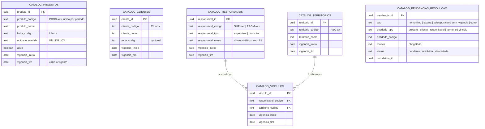

# Diagrama do modelo — catálogo canônico temporal (T4.1 / SPEC-1-004)

Todas as entidades têm vigência (`vigencia_inicio` obrigatória, `vigencia_fim` opcional — vazio significa vigente). A vigência vale pela **data da venda**, não pela data de hoje.

## Garantias do banco

| Garantia                                 | Como o banco garante                                                                                                                                                 |
| ---------------------------------------- | -------------------------------------------------------------------------------------------------------------------------------------------------------------------- |
| Sem sobreposição silentiosa              | Restrição de exclusão (`EXCLUDE USING gist`): duas vigências do **mesmo código** não podem se cruzar; um território não pode ter dois responsáveis no mesmo período. |
| Vigência coerente                        | `vigencia_fim` nunca anterior a `vigencia_inicio`; vazio = vigente.                                                                                                  |
| Homônimo não é associado automaticamente | Não existe unicidade por **nome** — dois registros podem ter o mesmo nome com códigos diferentes; a escolha é humana.                                                |
| Lacuna/ambiguidade viram pendência       | Tabela `catalog_pendencias_resolucao` com tipo, motivo obrigatório e `correlation_id`.                                                                               |
| Edição controlada                        | RLS: escrever exige a operação `editar_catalogo` (matriz da T1.1); leitura para autenticados.                                                                        |

## Fixtures temporais (arquivo `fixtures/temporal/seed_sintetico.sql`)

Cenários cobertos, todos sintéticos: vigência normal, vigência encerrada, tentativa de sobreposição (o banco recusa), homônimo (mesmo nome, códigos diferentes — vira pendência) e lacuna (período sem responsável — vira pendência). O seed **não é aplicado automaticamente**; será usado pela T4.2 nos testes de resolução.
